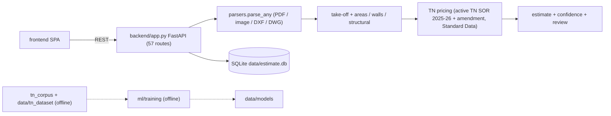

# 02 — Project architecture (verified against the live code)

These findings come from reading the entry points and tracing calls through the code, not from earlier reports.

**Diagrams:** `diagrams/system_architecture.mmd`, `dataset_pipeline.mmd`, `model_pipeline.mmd` and
`cost_estimation_pipeline.mmd` (Mermaid).

## A. Frontend

**Files:** `frontend/index.html`, `app.js` (795 lines, vanilla JS), `styles.css`. Served by FastAPI at `/`.

| Hash route | Workflow |
|---|---|
| `#/estimates` | list and create projects; TN district / authority selection |
| `#/p/<id>` | upload drawings; sheet previews; room, sheet and opening edits; quantity table with basis and assumption; mapping review; confidence badges; quality banner; confirm / reopen; report export |
| `#/rates` | active TN schedule, SOR search, ingestion status (admin) |
| `#/annotate` | annotation drafting and two-reviewer approval |

- **Status:** IMPLEMENTED, TESTED through API tests only. There are no browser or E2E tests, so the UI is not
  independently verified.

## B. Backend

- **Framework:** FastAPI + Uvicorn. **Entry point:** `backend/app.py` (1,466 lines, 57 routes).
- **Launch:** `start.bat` (venv → pip install → uvicorn on 127.0.0.1:8000).

| Route group | Routes | Module |
|---|---|---|
| projects / files / items / sheets / confirm / reopen / versions / exports | 22 | `app.py` |
| rate schedules / SOR / locations | 16 | `rates.py`, `tn_scope.py` |
| TN PWD ingestion `/api/tnpwd/*` | 3 | `tnpwd_ingestion/*` |
| annotations `/api/annotations*` | 8 | `annotations.py` |
| mapping review, reference BOQ, learning | 6 | `mapping_review.py`, `boq.py`, `learning.py` |
| health, samples, previews, reports | 7 | `app.py`, `reports.py` |

- **Processing path:** `POST /api/projects/{pid}/files` runs:
  1. `parsers.parse_any` produces sheets;
  2. `site_plan_reason`: site plans are never costed;
  3. `floors.parse`;
  4. `openings.reconcile`;
  5. `areas.compute`;
  6. `takeoff.compute_quantities`;
  7. `structural.compute` (BBS steel replaces the generic steel lines);
  8. `walls.compute`;
  9. `tn_pricing` (rates);
  10. `confidence`;
  11. `quality`.

  The result is stored as project JSON in SQLite.
- **Storage:** SQLite `data/estimate.db` (24 tables) with a 60 s timeout. Uploaded files are stored per project.
  Background work is synchronous within a request; there is no job queue.
- **Audit trail:**
  - estimate versions;
  - confirm / reopen lock (mapping review is refused while locked);
  - `tn_events`;
  - `mapping_reviews`;
  - corpus decision log.

## C. Computer vision

| Stage | Implementation | Status |
|---|---|---|
| Vector PDF primitives | `parsers.parse_pdf` + RandomForest primitive classifier | IMPLEMENTED; synthetic-only validation |
| Large vector sheets | `bigplan.py`, `sheetreader.py` (view splitting, titles) | IMPLEMENTED; sheet-view classification 88.9 % on exposed dev set |
| Raster segmentation | `segmodel.py` U-Net ONNX (wall / room / door / window) | IMPLEMENTED; CubiCasa metrics only |
| Object detection | `detector.py` YOLOv8s ONNX + wall-gate filter | IMPLEMENTED; CubiCasa metrics only |
| OCR | RapidOCR (ONNX, pretrained) via `parsers.ocr` | IMPLEMENTED; no TN OCR accuracy measured |
| DXF / DWG | `parsers.parse_dxf` (ezdxf), DWG via bundled LibreDWG `dwg2dxf.exe` | IMPLEMENTED; synthetic DXF exact-geometry test 100 % |
| Opening reconciliation | `openings.reconcile` (geometry vs schedule vs detector; conflicts flagged, never auto-resolved) | IMPLEMENTED, TESTED |

## D–E. ML and NLP

See 04.

## F. Quantities

See 09: `takeoff.py`, `areas.py`, `walls.py`, `structural.py`, `floors.py`, with the item map in
`data/tnpwd/maps/takeoff_tn.json` (53 items).

## G. Pricing

See 10: there is **one active schedule**, TN SOR 2025-26 Vol I with the 08.08.2025 amendment (3,502 items), plus 514
Standard Data analyses. 41 other-state / CPWD schedules are kept **inactive** for audit of legacy projects. `tn_scope.py`
rejects any non-TN location or schedule.

## H. BOQ / costing

See 11: `takeoff.price`, `boq.py` (validate, compare, metrics), and `learning.py` (learning from confirmed estimates; 0
rows).

## I. Data management

See 05 and 13:
- `data/tn_dataset` (split v2, the development dataset);
- `tn_corpus/` (new governed candidate corpus);
- the two are linked only through manifests.

## J. Operations

- **Dependencies:** `requirements.txt` uses lower bounds only (no lock file). `requests` was **missing** and has been
  added in this run.
- **Training dependencies** (torch, ultralytics) are not in the requirements; they are an offline GPU environment.
- **Logging:** stdout. There is no deployment config beyond local `start.bat`, and no authentication on the API (see 15).

## Module status classification

| Status | Modules |
|---|---|
| Implemented & verified (acceptance criterion met with evidence) | site-plan guard on 4 smoke images (3 of 4 → not met, so none qualify); **no module meets a TN accuracy criterion** |
| Implemented, tested, not validated on TN | parsers, segmodel, detector, openings, areas, walls, structural, floors, takeoff, tn_pricing, rate_analysis, boq, mapping_review, confidence, annotations, quality |
| Present, not in the live estimate path | `learning.py` (wired but 0 data), `analysis.py`, `south_compare.py`, `aparna_regression.py`, `commercial_eval.py`, `accuracy_eval.py`, `benchmark.py`, `real_eval.py`, `tn_eval.py`, `opening_ab.py` (evaluation / dev scripts) |
| Offline only | `ml/training/*`, `ml/evaluation/*`, `tn_corpus/scripts/*`, `backend/tn_data_ingestion/*` |
| Historical | `models_v3.joblib`, `models_v4.joblib` (only v5 is loaded); split v1 folders |
| Missing | browser E2E tests; authentication; background job queue; TN-trained models; calibrated confidence |
